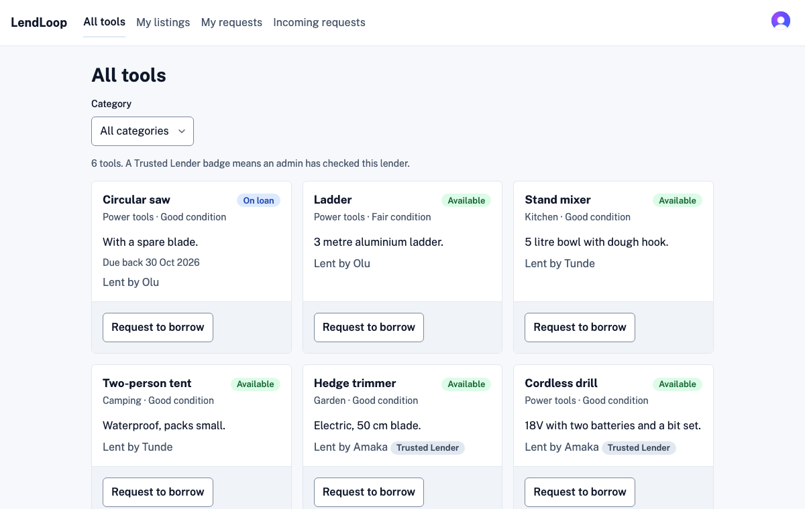
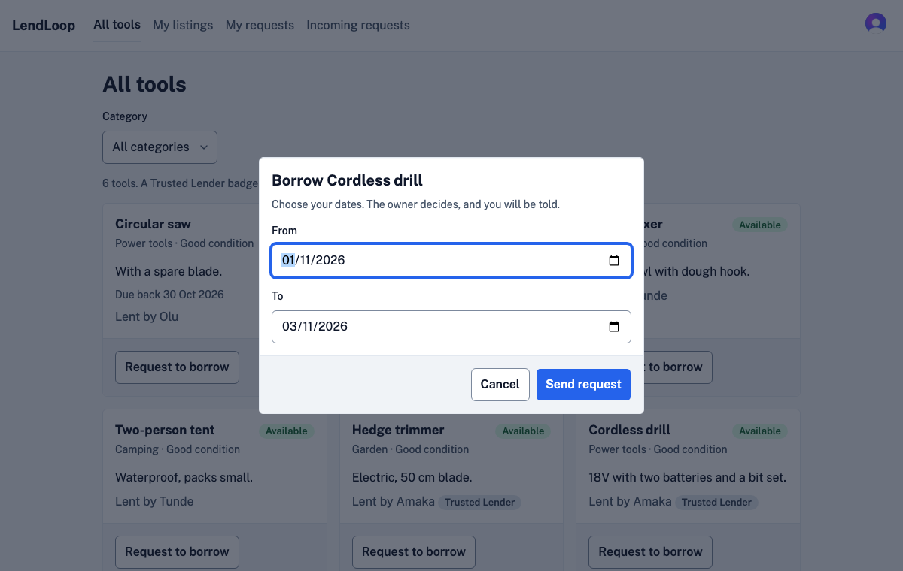
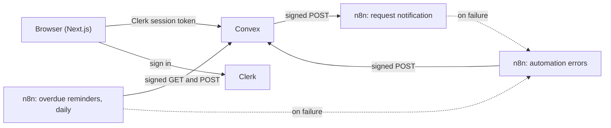

# LendLoop

LendLoop is a neighborhood tool-lending board. Neighbors list tools, ask to borrow them for some dates, and the owner approves or declines. n8n sends the notifications and the daily overdue reminders, and everything it does is signed, retried and visible in the app. The brief is in [docs/BRIEF.md](docs/BRIEF.md).





A [short recording](docs/images/flow.webm) shows a request going from borrower to owner.

**Contents:** [Architecture](#architecture), [Local setup](#local-setup), [Environment variables](#environment-variables), [Roles](#roles), [Security and data](#security-and-data), [Automation](#automation), [Tests](#tests), [Decisions](#decisions), [Production](#what-i-would-change-for-production), [Known limits](#known-limits).

## Architecture



The stack is Next.js 16 (App Router), Clerk, Convex, n8n 2 in Docker, TypeScript in strict mode, Tailwind 4 and shadcn/ui. All versions are pinned.

**Backend layers.** `convex/*.ts` holds the functions. Each one declares its arguments and checks permission, and some also hold rules that only they use. `convex/model/` holds data access and the rules that functions share. `convex/lib/` holds pure helpers, the auth wrappers and the permission rules. `http.ts` only verifies, parses and calls internal functions.

**Frontend layers.** `src/app/` holds routes, and pages are server components. `src/components/{tools,loans,admin}` hold features, where `*-view` files, and the lists and tables that page their own rows, fetch data. Other children take props. `layout` and `common` are shared, and `ui` is shadcn only. Server data lives in Convex subscriptions, the category filter in the URL, and form state in react-hook-form, so there is no global store.

ESLint enforces these layers, so an import in the wrong direction fails lint, and CI runs lint. The design rules are in [docs/design.md](docs/design.md).

## Local setup

You need Node.js 22, npm and Docker Desktop. Convex runs locally, so it needs no account. Clerk needs a free development application.

1. Install, and create your env file:

   ```bash
   npm install
   cp .env.example .env.local
   ```

2. In the [Clerk dashboard](https://dashboard.clerk.com), create an application and turn on the Convex integration. Under Configure, Sessions, "Customize session token", add these claims:

   ```json
   {
     "aud": "convex",
     "email": "{{user.primary_email_address}}",
     "name": "{{user.full_name}}"
   }
   ```

   Put `NEXT_PUBLIC_CLERK_PUBLISHABLE_KEY` and `CLERK_SECRET_KEY` in `.env.local`.

3. Start Convex in its own terminal. The first push stops until Convex knows your Clerk issuer, so set it from a second terminal, using your Clerk Frontend API URL:

   ```bash
   CONVEX_AGENT_MODE=anonymous npm run dev:backend
   npx convex env set CLERK_JWT_ISSUER_DOMAIN https://your-app.clerk.accounts.dev
   ```

4. Create the signing secrets, and start n8n:

   ```bash
   npm run secrets:setup
   docker compose up -d
   npm run n8n:setup
   ```

5. Start the app, and open http://localhost:3000:

   ```bash
   npm run dev
   ```

6. After you sign in once, make yourself an admin and add demo data:

   ```bash
   npm run admin:grant -- you@example.com
   npx convex env set ALLOW_DEMO_SEED true
   npx convex run seed:demo '{"forEmail":"you@example.com"}'
   npm run n8n:remind-now
   ```

## Environment variables

`.env.example` and `n8n/.env.example` list the names, and no tracked file holds a value.

| Name                                                                         | Where              | Purpose                                 |
| ---------------------------------------------------------------------------- | ------------------ | --------------------------------------- |
| `NEXT_PUBLIC_CLERK_PUBLISHABLE_KEY`, `CLERK_SECRET_KEY`                      | `.env.local`       | Clerk keys                              |
| `CONVEX_DEPLOYMENT`, `NEXT_PUBLIC_CONVEX_URL`, `NEXT_PUBLIC_CONVEX_SITE_URL` | `.env.local`       | Written by Convex                       |
| `E2E_CLERK_OWNER_EMAIL`, `E2E_CLERK_BORROWER_EMAIL`, `E2E_CLERK_ADMIN_EMAIL` | `.env.local`       | Test users, from `npm run e2e:users`    |
| `CLERK_JWT_ISSUER_DOMAIN`, `N8N_WEBHOOK_URL`, `ALLOW_DEMO_SEED`              | Convex             | Token issuer, webhook, demo data switch |
| `CONVEX_TO_N8N_SECRET`, `N8N_TO_CONVEX_SECRET`                               | Convex, `n8n/.env` | One signing secret per direction        |
| `N8N_ENCRYPTION_KEY`                                                         | `n8n/.env`         | n8n's own key                           |

## Roles

The role lives only in the Convex `users` table, and every rule is enforced in Convex functions.

| Action                                            | Who                                            |
| ------------------------------------------------- | ---------------------------------------------- |
| See the public list                               | Anyone                                         |
| List a tool, request to borrow                    | Any signed-in user                             |
| Edit a tool                                       | The owner                                      |
| Remove a tool                                     | The owner, if it has no open loan, or an admin |
| Approve, decline, call off, mark returned         | The tool owner                                 |
| Cancel a request or a loan that has not started   | The borrower                                   |
| See all loans and failures, mark a Trusted Lender | An admin                                       |
| Make someone an admin                             | Only the command line                          |

## Security and data

The app keeps personal data to what each person needs. The public page shows only name and category. Neighbors see each other's email only on an approved loan, because they need to arrange pickup. Webhook payloads carry only what the sender needs, logs hold IDs and masked emails, and n8n deletes failed runs after 7 days. [docs/security.md](docs/security.md) has the threat table and the full list.

## Automation

Convex signs each notification, retries it after failures, and records every attempt on the loan. A daily n8n workflow claims each overdue loan before it sends, so a second run reminds nobody twice. An error workflow reports failed runs to the admin page. Each loan shows its recent activity, for example "The borrower was reminded, 2 days ago". [docs/integration.md](docs/integration.md) explains the signing, idempotency and retries.

## Tests

| Command            | What it runs                                                                       |
| ------------------ | ---------------------------------------------------------------------------------- |
| `npm test`         | Backend and component tests, including a role table covering every public function |
| `npm run test:e2e` | Browser tests: public and signed-in flows, axe in both themes, phone width, CSP    |
| `npm run test:n8n` | Live tests against the real n8n, including an outage and a failed scheduled run    |

Run `npm run e2e:users` once before the signed-in tests. CI runs lint, types, unit tests, format, the export check, the audit, the build and a secret scan. Browser tests stay local, because they need Clerk keys and a live backend.

## Decisions

- **Convex dates use a `today` argument in queries,** because a cached query cannot see the clock change.
- **Removing a tool is a soft delete,** so loan history stays readable. An admin's removal declines future loans and leaves a loan under way open, because the tool must still come back.
- **Notifications are mock logs,** which the brief allows, and the payload is ready for a real sender.
- **The public list shows the newest 24 available tools,** rendered on the server, with a sign-in link for the rest.

## What I would change for production

1. Use production Convex and Clerk instances, with secrets in the host's secret store.
2. Run n8n with HTTPS, Postgres and queue mode, with the editor behind single sign-on. Rate limit its webhook, because the signature check runs inside the workflow, so an unsigned call still does some work.
3. Send real email, and use `eventId` to drop duplicates.
4. Add a key id to signatures, so secrets can rotate without downtime.
5. Clear stale `sending` claims, so a crash does not skip a day.
6. Add error monitoring, CSP violation reports, and alerts on failure events.
7. Add an audit log for admin actions, and retention for automation events.
8. Delete a user's data when their Clerk account is deleted.
9. Run browser tests in CI against a test environment, and use widen, migrate, narrow for schema changes.

## Known limits

- A crash between a claim and its write-back skips that loan's reminder until the next day.
- The overdue feed stops at 500 loans and logs that it did. Reminded loans still count toward the 500.
- n8n cannot report its own outage. While it is stopped, a scheduled run leaves no trace, so no row appears on the Failures tab for the missed reminders. Notifications do appear there once they run out of attempts.
- A signed notification replayed within 300 seconds sends again. Write-backs are not affected.
- Dates are UTC, and a borrower's local date can differ by a day.
- A sign-in redirect was seen once, on a first load of `/board`, and was not reproduced.
- No screen reader test has been run.
